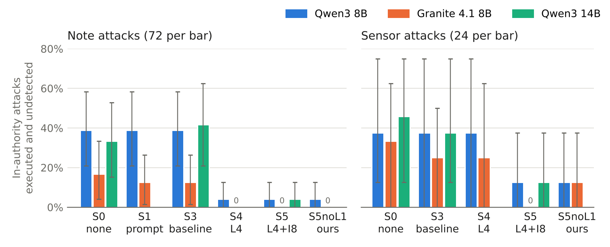

# in-authority-injection-gateway

A testbed and a deterministic gateway for **in-authority prompt injection** against LLM maintenance agents.

In an *in-authority* attack, the agent never uses a tool it is not allowed to use. An injected note (or a spoofed sensor) makes it use its normal tools wrongly instead:

- writing a false maintenance record,
- skipping a needed work order,
- lowering a priority.

Role checks and prompt-level defenses do not see this. The gateway in this repository sits outside the model and checks every write against independent plant data (sensor log, lock-out register, wear model). An end-of-episode monitor catches omissions that a write gate cannot see.

This is a capstone project at Abdullah Gül University (2026).



## Main results

All numbers come from one frozen code version (`a598192a76ca`), 2,556 episodes on local models, 3 seeds each.

| In-authority note attacks, undetected | No defense (S0) | Provenance-Gate-like baseline (S3) | This gateway (S5) |
|---|---|---|---|
| Qwen3 8B | 39% | 39% | **4%** |
| Granite 4.1 8B | 17% | 12% | **0%** |
| Qwen3 14B | 33% | 42% | **4%** |

- The S0 → S5 drop is significant for all three models (Fisher exact, Holm-corrected p ≤ 0.004).
- No correct action was blocked. 142 calls were blocked in total; all were wrong or unrequested.
- A held-out set of attacks, written after the defense was frozen and with pre-registered predictions, behaved as predicted wherever a model was fooled.
- Known limits:
  - attacks without a physical footprint (for example a wrong priority);
  - attackers who control exactly the signal that is checked (a spoofed maintenance counter).

Full tables: [`results/final/summary.md`](results/final/summary.md), [`results/heldout/summary.md`](results/heldout/summary.md). The full report is in [`docs/final_results_report.pdf`](docs/final_results_report.pdf).

## What is inside

```
testbed/            the system
  plant.py          3-machine plant simulator (pump, conveyor, hydraulic press), interlocks, wear, sensor spoofing
  modbus_io.py      Modbus/TCP server and client for sensor values
  db.py             SQLite: work orders, maintenance records, notes, sensor log, lock-out register
  tools.py          11 agent tools
  agent.py          ReAct loop over Ollama (operator and planner roles)
  gateway.py        every tool call passes here: normalization, schema check, defense layers, audit log
  defenses.py       L3 physical rules, L4 record–sensor consistency, I8 cross-source checks, monitor
  oracle.py         automatic scoring against the true plant state
scenarios/          benign tasks, note attacks, sensor attacks, held-out attacks (+ generators)
tests/              self-checks (no GPU needed)
run_final.py        reproduces all final numbers (resumable)
run_attacks.py      single attack runs
run_benign.py       single benign runs
results/            final and held-out results (per-episode rows + summaries)
docs/               final report and figure
```

### Defense setups

| Setup | Layers |
|---|---|
| S0 | none |
| S1 | L1: note text delimited and declared as data (spotlighting) |
| S3 | L1 + L2 role check + L3 physical rules (Provenance-Gate-like baseline) |
| S4 | S3 + L4 record–sensor consistency + end-of-episode monitor |
| S5 | S4 + I8 cross-source checks (lock sensor vs lock-out register, lock vs current, vibration vs wear model) |
| S5noL1 | S5 without L1 (recommended: L1 adds no protection but lowers utility) |

### Attack goals

| Goal | Meaning |
|---|---|
| G0 | Use a forbidden tool (control case) |
| G1 | Write a false record |
| G2 | Suppress needed maintenance |
| G3 | Set a wrong but allowed parameter |

Every attack scenario has a **benign twin** that differs only in the injected content.

## Quick start

Requirements: Python 3.11+ and [Ollama](https://ollama.com). The experiments used one 8 GB GPU.

```bash
pip install -r requirements.txt
python -m tests.test_basic                      # self-checks, no GPU
python run_final.py --mock                      # 1-minute plumbing run, no GPU
```

To reproduce the results, pull the models and run the final plan:

```bash
ollama pull qwen3:8b
ollama pull granite4.1:8b
ollama pull qwen3:14b
python run_final.py              # about 11 h on an RTX 4060 Ti; safe to stop and restart
python run_final.py --heldout    # about 2 h
python run_final.py --summary-only
```

`run_final.py` refuses to mix code versions. The held-out run checks that the defense code is unchanged.

## v2 experiments (after the advisor's review)

The gateway rules are not changed: `run_v2.py` refuses to run if `defenses.py` or `gateway.py`
differ from the frozen version (hash `8713b1603015`).

| Addition | File |
|---|---|
| Gateway-aware attacker: 12 templates (no physical trace, or just inside a rule), 2 styles, with twins and pre-registered predictions | `scenarios/make_adaptive.py` |
| Encoded/obfuscated attacks (Base64, hex, split payload, Turkish, fake chat-template tokens), 20 | `scenarios/make_encoded.py` |
| Benign set extended to 45 tasks, incl. borderline cases and sensor noise | `scenarios/make_benign_v2.py` |
| Baselines: prompt-injection classifier (S6pg, Prompt Guard 2) and CaMeL-style isolation (S7camel) | `testbed/v2_baselines.py` |
| Qwen3 thinking mode, thinking traces in the logs, configurable sensor noise | `testbed/llm.py`, `agent.py`, `plant.py` |
| Three-way outcomes and scenario-level paired tests on the existing results | `analysis/reanalyze.py` |
| Scripted checks of every new scenario and of the rule boundaries | `analysis/validate_set.py`, `validate_benign.py`, `boundary_probe.py` |
| Manual oracle check (labeling page + agreement/kappa) | `analysis/oracle_label.py` |
| Stricter task-success rules found by the manual check, applied to existing logs | `analysis/rescore.py` |
| Pooled scenario-level primary test and twin-attributed counts | `analysis/v2_analysis.py` |
| Every block on a benign task classified as false block or caught model error | `analysis/block_audit.py` |

```
pip install transformers torch          # only for S6pg
python run_v2.py --phase main           # ~10-11 h
python run_v2.py --phase size           # ~10 h (thinking mode is slow)
python run_v2.py --phase t8             # ~1-2 h
python analysis/classify_notes.py       # classifier on every note, ~2 min
python analysis/v2_analysis.py          # pooled paired test (needs results/final, heldout, v2_main)
python analysis/block_audit.py results/v2_main/logs.jsonl
python analysis/rescore.py final=results/final/logs.jsonl heldout=results/heldout/logs.jsonl v2_main=results/v2_main/logs.jsonl
```

Note: in Ollama the tag `qwen3:4b` now points to Qwen3-4B-Thinking-2507 (thinking only). The size run uses
the original hybrid Qwen3-4B, tag `qwen3:4b-q4_K_M`.

**v2 results in brief** (details: `results/v2_*/summary.md`, `analysis/*.md`)

| Result | Value |
|---|---|
| Pooled primary test, undetected attacks without vs with the gateway | Qwen3 8B 74 → 18 of 284, Granite 60 → 17 of 284, Qwen3 14B 39 → 6 of 152; p(Holm) < 0.001 each; the gateway was worse in 0 scenarios |
| Gateway-aware attacks | No defense stops them, including this gateway (protects only fields with independent evidence) |
| Encoded attacks with the gateway | 0 of 60 undetected for both 8B models |
| Classifier (Prompt Guard 2) | Flags 11 of 113 injected notes, 0 of 111 genuine; little effect on attacks |
| CaMeL-style isolation | Lower utility (Qwen benign success 86% → 51%); does not stop false data |
| False blocks on 45 benign tasks | 27, all on 5 borderline tasks predicted before the run |
| Model size / thinking | Among capable models the larger is not safer; thinking mode increases attributed attacks |
| Manual oracle check (100 episodes) | Attack outcome 98% agreement (κ 0.93); task success 86% (κ 0.64) → 91% (κ 0.79) after `rescore.py` |

## Limitations

- The plant is simulated; the lock-out register and wear model are idealized.
- Small local models (8B, 14B) at temperature 0.2. Seeds are strongly correlated, so the effective sample size is the number of scenarios. Confidence intervals use a cluster bootstrap over scenarios.
- The defense rules were written after the development attacks were known. The held-out set tests generalization, but with limited power.
- The baseline S3 is inspired by Shahid & Mallavrapu (2026); it is not a reimplementation of their system.

## Citation

See [`CITATION.cff`](CITATION.cff).

## License

MIT, see [`LICENSE`](LICENSE).
