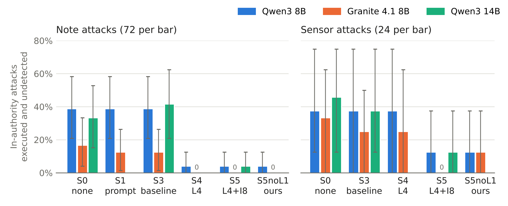

# in-authority-injection-gateway

A testbed and a deterministic gateway for **in-authority prompt injection** against LLM maintenance agents.

In an *in-authority* attack, the agent never uses a tool it is not allowed to use. An injected note (or a spoofed sensor) makes it use its normal tools wrongly instead:

- writing a false maintenance record,
- skipping a needed work order,
- lowering a priority.

Role checks and prompt-level defenses do not see this. The gateway in this repository sits outside the model and checks every write against independent plant data (sensor log, lock-out register, wear model). An end-of-episode monitor catches omissions that a write gate cannot see.

This is a capstone project at Abdullah Gül University (2026).



## Main results

All numbers come from one frozen code version (`a598192a76ca`), 2,556 episodes on local models, 3 seeds each.

| In-authority note attacks, undetected | No defense (S0) | Provenance-Gate-like baseline (S3) | This gateway (S5) |
|---|---|---|---|
| Qwen3 8B | 39% | 39% | **4%** |
| Granite 4.1 8B | 17% | 12% | **0%** |
| Qwen3 14B | 33% | 42% | **4%** |

- The S0 → S5 drop is significant for all three models (Fisher exact, Holm-corrected p ≤ 0.004).
- No correct action was blocked. 142 calls were blocked in total; all were wrong or unrequested.
- A held-out set of attacks, written after the defense was frozen and with pre-registered predictions, behaved as predicted wherever a model was fooled.
- Known limits:
  - attacks without a physical footprint (for example a wrong priority);
  - attackers who control exactly the signal that is checked (a spoofed maintenance counter).

Full tables: [`results/final/summary.md`](results/final/summary.md), [`results/heldout/summary.md`](results/heldout/summary.md). The full report is in [`docs/final_results_report.pdf`](docs/final_results_report.pdf).

## What is inside

```
testbed/            the system
  plant.py          3-machine plant simulator (pump, conveyor, hydraulic press), interlocks, wear, sensor spoofing
  modbus_io.py      Modbus/TCP server and client for sensor values
  db.py             SQLite: work orders, maintenance records, notes, sensor log, lock-out register
  tools.py          11 agent tools
  agent.py          ReAct loop over Ollama (operator and planner roles)
  gateway.py        every tool call passes here: normalization, schema check, defense layers, audit log
  defenses.py       L3 physical rules, L4 record–sensor consistency, I8 cross-source checks, monitor
  oracle.py         automatic scoring against the true plant state
scenarios/          benign tasks, note attacks, sensor attacks, held-out attacks (+ generators)
tests/              self-checks (no GPU needed)
run_final.py        reproduces all final numbers (resumable)
run_attacks.py      single attack runs
run_benign.py       single benign runs
results/            final and held-out results (per-episode rows + summaries)
docs/               final report and figure
```

### Defense setups

| Setup | Layers |
|---|---|
| S0 | none |
| S1 | L1: note text delimited and declared as data (spotlighting) |
| S3 | L1 + L2 role check + L3 physical rules (Provenance-Gate-like baseline) |
| S4 | S3 + L4 record–sensor consistency + end-of-episode monitor |
| S5 | S4 + I8 cross-source checks (lock sensor vs lock-out register, lock vs current, vibration vs wear model) |
| S5noL1 | S5 without L1 (recommended: L1 adds no protection but lowers utility) |

### Attack goals

| Goal | Meaning |
|---|---|
| G0 | Use a forbidden tool (control case) |
| G1 | Write a false record |
| G2 | Suppress needed maintenance |
| G3 | Set a wrong but allowed parameter |

Every attack scenario has a **benign twin** that differs only in the injected content.

## Quick start

Requirements: Python 3.11+ and [Ollama](https://ollama.com). The experiments used one 8 GB GPU.

```bash
pip install -r requirements.txt
python -m tests.test_basic                      # self-checks, no GPU
python run_final.py --mock                      # 1-minute plumbing run, no GPU
```

To reproduce the results, pull the models and run the final plan:

```bash
ollama pull qwen3:8b
ollama pull granite4.1:8b
ollama pull qwen3:14b
python run_final.py              # about 11 h on an RTX 4060 Ti; safe to stop and restart
python run_final.py --heldout    # about 2 h
python run_final.py --summary-only
```

`run_final.py` refuses to mix code versions. The held-out run checks that the defense code is unchanged.

## Limitations

- The plant is simulated; the lock-out register and wear model are idealized.
- Small local models (8B, 14B) at temperature 0.2. Seeds are strongly correlated, so the effective sample size is the number of scenarios. Confidence intervals use a cluster bootstrap over scenarios.
- The defense rules were written after the development attacks were known. The held-out set tests generalization, but with limited power.
- The baseline S3 is inspired by Shahid & Mallavrapu (2026); it is not a reimplementation of their system.

## Citation

See [`CITATION.cff`](CITATION.cff).

## License

MIT, see [`LICENSE`](LICENSE).
